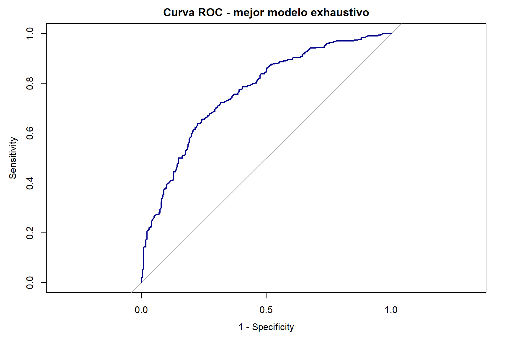
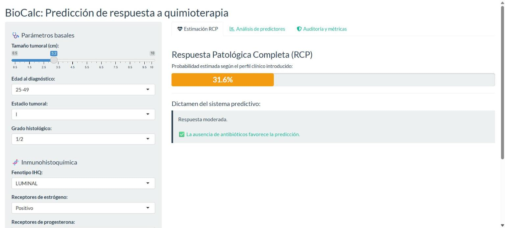

# Cáncer de mama: ¿influyen los antibióticos en la respuesta a la quimioterapia neoadyuvante?

Análisis de minería de datos sobre una cohorte clínica de pacientes con cáncer de mama para estudiar si el uso de antibióticos durante la quimioterapia neoadyuvante afecta a la **respuesta patológica completa (RCP)**. El trabajo va desde la limpieza de los datos hasta un modelo predictivo desplegado como aplicación web (BioCalc).

*Data mining study in R on a breast cancer cohort: does antibiotic use during neoadjuvant chemotherapy affect pathological complete response? Includes cleaning and multiple imputation, inferential analysis, logistic regression, model comparison with nested cross-validation and an R Shiny app.*

🇬🇧 **English version:** [read it below](#english-version)

Lo hemos hecho como práctica individual de **Minería de Datos** del Grado en Ingeniería de la Salud (Universidad de Málaga, junio de 2026).

**Informe completo:** [antoniodoa9.github.io/cancer-mama-respuesta-neoadyuvante](https://antoniodoa9.github.io/cancer-mama-respuesta-neoadyuvante/) (con todo el código R desplegable).

**Aplicación BioCalc en línea:** [antonio-sanchez-uma.shinyapps.io/biocalc](https://antonio-sanchez-uma.shinyapps.io/biocalc/)



## Qué hemos hecho

1. **Análisis univariante** de cada variable y detección de valores anómalos (como los códigos 999).
2. **Limpieza e imputación múltiple** de los valores perdidos con `mice`, y recodificación y discretización de las variables.
3. **Análisis bivariante** con contrastes de hipótesis entre cada variable y la RCP.
4. **Regresión logística** con selección de variables *stepwise* y comparación entre casos completos y datos imputados.
5. **Modelo predictivo**: *repeated hold-out*, búsqueda exhaustiva de combinaciones de variables, curva ROC y validación cruzada *k-fold*.
6. **Comparación de algoritmos** (regresión regularizada, SVM, Random Forest, árboles de decisión y Naive Bayes) con validación cruzada anidada 5x2.
7. **Despliegue** del modelo final en una aplicación R Shiny, BioCalc, que estima la probabilidad de RCP de una paciente nueva.

## Resultados principales

- Las pacientes que **no** tomaron antibióticos alcanzaron la RCP en el **48.1 %** de los casos, frente al **38 %** de las que sí los tomaron (p = 0.011).
- El uso de antibióticos se mantiene como un factor que empeora la probabilidad de RCP también en el modelo multivariante, junto con el estadio, el tamaño del tumor, la edad y el fenotipo.
- SVM, regresión regularizada y Random Forest dan un rendimiento casi idéntico, con un AUC por encima de 0.75. El árbol de decisión simple queda el último (AUC = 0.713).


## BioCalc

La aplicación permite introducir el tamaño del tumor, la edad, el estadio, el fenotipo y el resto de variables del modelo, y devuelve la probabilidad estimada de RCP junto con un aviso sobre el efecto de los antibióticos.



## Estructura del repositorio

```
InformeMineria.qmd    código fuente del informe (Quarto + R)
index.html            informe completo ya renderizado en HTML, con el código R desplegable
figuras/              gráficas del informe y captura de BioCalc
biocalc_shiny/app.R   código de la aplicación Shiny BioCalc
```

## Cómo reproducirlo

1. Instalar R, RStudio (o Quarto) y los paquetes que se cargan al principio del informe (`readxl`, `dplyr`, `ggplot2`, `patchwork`, `mice`, `MASS`, `caret`, `pROC`, `glmnet`, `e1071`, `randomForest` y `rpart`).
2. Copiar el fichero de datos `muestra_700_UGC_perdidos.xlsx` en una carpeta `datos/` junto al `.qmd` (los datos no están en el repositorio, ver más abajo).
3. Renderizar `InformeMineria.qmd` con el botón *Render* de RStudio o con `quarto render InformeMineria.qmd`. Al final se genera también `modelo_rcp.rds`, que es el modelo que usa BioCalc.

## Datos

Los datos son de una cohorte clínica real cedida a la asignatura y **no se publican**. El repositorio solo contiene el informe con resultados agregados (resúmenes, gráficas y modelos), el código y la aplicación. Por la misma razón no se incluye el modelo entrenado (`modelo_rcp.rds`), que guarda internamente los datos de entrenamiento; para ejecutar BioCalc hay que generarlo antes con el código del informe.

## Aviso

Es un trabajo académico y BioCalc no está validado clínicamente: no debe usarse para tomar decisiones médicas.

## Autor

Antonio Sánchez Doña.

---

## English version

Data mining analysis of a clinical cohort of breast cancer patients, to study whether antibiotic use during neoadjuvant chemotherapy affects **pathological complete response (pCR)**. The work goes from data cleaning to a predictive model deployed as a web app (BioCalc).

This was an individual assignment for **Data Mining** in the Health Engineering degree (University of Málaga, June 2026).

**Full report:** [antoniodoa9.github.io/cancer-mama-respuesta-neoadyuvante](https://antoniodoa9.github.io/cancer-mama-respuesta-neoadyuvante/) (with all the R code, which can be expanded). **BioCalc app online:** [antonio-sanchez-uma.shinyapps.io/biocalc](https://antonio-sanchez-uma.shinyapps.io/biocalc/)

### What we did

1. **Univariate analysis** of each variable and detection of anomalous values (such as 999 codes).
2. **Cleaning and multiple imputation** of missing values with `mice`, plus recoding and discretisation of the variables.
3. **Bivariate analysis** with hypothesis tests between each variable and pCR.
4. **Logistic regression** with stepwise variable selection, comparing complete cases with imputed data.
5. **Predictive model**: repeated hold-out, exhaustive search of variable combinations, ROC curve and k-fold cross-validation.
6. **Algorithm comparison** (regularised regression, SVM, Random Forest, decision trees and Naive Bayes) with 5x2 nested cross-validation.
7. **Deployment** of the final model in an R Shiny app, BioCalc, which estimates the probability of pCR for a new patient.

### Main results

- Patients who did **not** take antibiotics reached pCR in **48.1 %** of cases, compared with **38 %** of those who did (p = 0.011).
- Antibiotic use remains a factor that lowers the probability of pCR in the multivariable model too, together with stage, tumour size, age and phenotype.
- SVM, regularised regression and Random Forest perform almost the same, with an AUC above 0.75. The simple decision tree comes last (AUC = 0.713).

### BioCalc

The app lets you enter the tumour size, age, stage, phenotype and the rest of the model variables, and returns the estimated probability of pCR together with a note on the effect of antibiotics.

### How to reproduce it

1. Install R, RStudio (or Quarto) and the packages loaded at the start of the report (`readxl`, `dplyr`, `ggplot2`, `patchwork`, `mice`, `MASS`, `caret`, `pROC`, `glmnet`, `e1071`, `randomForest` and `rpart`).
2. Copy the data file `muestra_700_UGC_perdidos.xlsx` into a `datos/` folder next to the `.qmd` (the data are not in the repository, see below).
3. Render `InformeMineria.qmd` with the *Render* button in RStudio or with `quarto render InformeMineria.qmd`. At the end it also creates `modelo_rcp.rds`, which is the model BioCalc uses.

### Data

The data come from a real clinical cohort shared with the course and **are not published**. The repository only contains the report with aggregated results (summaries, plots and models), the code and the app. For the same reason the trained model (`modelo_rcp.rds`) is not included, because it stores the training data inside; to run BioCalc you first need to create it with the report code.

### Disclaimer

This is an academic project and BioCalc is not clinically validated: it must not be used to make medical decisions.

### Author

Antonio Sánchez Doña.
