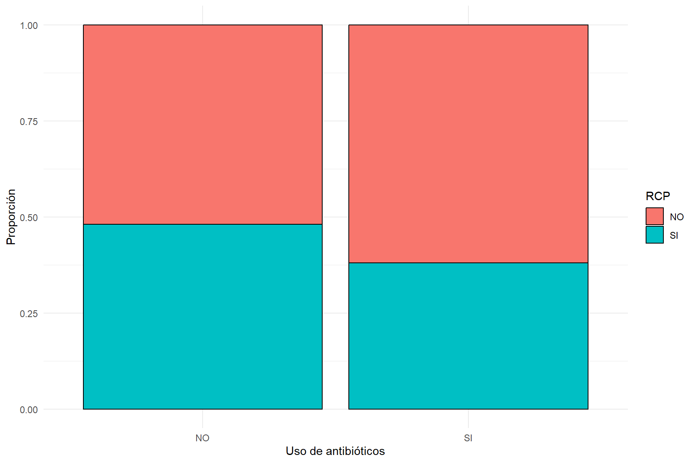

# Cáncer de mama: ¿influyen los antibióticos en la respuesta a la quimioterapia neoadyuvante?

Análisis de minería de datos sobre una cohorte clínica de pacientes con cáncer de mama para estudiar si el uso de antibióticos durante la quimioterapia neoadyuvante afecta a la **respuesta patológica completa (RCP)**. El trabajo va desde la limpieza de los datos hasta un modelo predictivo desplegado como aplicación web (BioCalc).

*Data mining study in R on a breast cancer cohort: does antibiotic use during neoadjuvant chemotherapy affect pathological complete response? Includes cleaning and multiple imputation, inferential analysis, logistic regression, model comparison with nested cross-validation and an R Shiny app.*

Lo hemos hecho como práctica individual de **Minería de Datos** del Grado en Ingeniería de la Salud (Universidad de Málaga, junio de 2026).

**Informe completo:** [antoniodoa9.github.io/cancer-mama-respuesta-neoadyuvante](https://antoniodoa9.github.io/cancer-mama-respuesta-neoadyuvante/) (con todo el código R desplegable).


## Qué hemos hecho

1. **Análisis univariante** de cada variable y detección de valores anómalos (como los códigos 999).
2. **Limpieza e imputación múltiple** de los valores perdidos con `mice`, y recodificación y discretización de las variables.
3. **Análisis bivariante** con contrastes de hipótesis entre cada variable y la RCP.
4. **Regresión logística** con selección de variables *stepwise* y comparación entre casos completos y datos imputados.
5. **Modelo predictivo**: *repeated hold-out*, búsqueda exhaustiva de combinaciones de variables, curva ROC y validación cruzada *k-fold*.
6. **Comparación de algoritmos** (regresión regularizada, SVM, Random Forest, árboles de decisión y Naive Bayes) con validación cruzada anidada 5x2.
7. **Despliegue** del modelo final en una aplicación R Shiny, BioCalc, que estima la probabilidad de RCP de una paciente nueva.

## Resultados principales

- Las pacientes que **no** tomaron antibióticos alcanzaron la RCP en el **48.1 %** de los casos, frente al **38 %** de las que sí los tomaron (p = 0.011).
- El uso de antibióticos se mantiene como un factor que empeora la probabilidad de RCP también en el modelo multivariante, junto con el estadio, el tamaño del tumor, la edad y el fenotipo.
- SVM, regresión regularizada y Random Forest dan un rendimiento casi idéntico, con un AUC por encima de 0.75. El árbol de decisión simple queda el último (AUC = 0.713).



## Estructura del repositorio

```
index.html            informe completo en HTML (Quarto), con el código R desplegable
figuras/              gráficas del informe
biocalc_shiny/app.R   código de la aplicación Shiny BioCalc
```

## Datos

Los datos son de una cohorte clínica real cedida a la asignatura y **no se publican**. El repositorio solo contiene el informe con resultados agregados (resúmenes, gráficas y modelos), el código y la aplicación. Por la misma razón no se incluye el modelo entrenado (`modelo_rcp.rds`), que guarda internamente los datos de entrenamiento; para ejecutar BioCalc hay que generarlo antes con el código del informe.

## Aviso

Es un trabajo académico y BioCalc no está validado clínicamente: no debe usarse para tomar decisiones médicas.

## Autor

Antonio Sánchez Doña.
